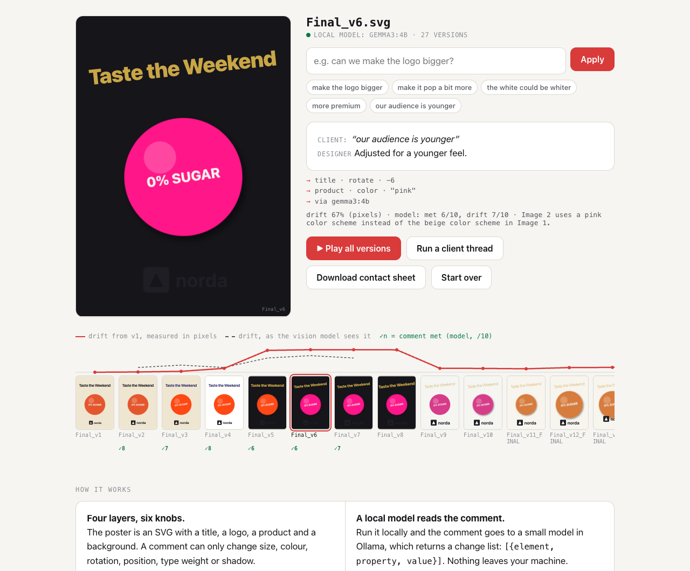

# finalfinal

*Screenshot from a real local run with gemma3:4b. Comments after v6 come from the built-in client thread; "norda" is a made-up brand.*

finalfinal turns a client comment into a concrete change to a poster, saves each result as the next `Final_vN`, and plays the whole revision history back.

Part 1 of the series **Night Shift**: machines built in one night, explained in one sentence, and the trick behind each is shown at the end.

**Status:** first working version. The page works on its own with a 14-rule rulebook; with the local server, comments go to a small Ollama model and a vision model scores each version. Tested on macOS with Chromium and gemma3:4b.

Revisions today run on email threads, screenshots with red circles and file names like `poster_final_v3_FINAL_use-this.pdf`. The comment is vague ("make it pop"), the result is a surprise to both sides, and the archive is a folder nobody can read. finalfinal is a toy about that loop, but the loop is real: a vague sentence becomes a measurable change on a layered SVG.

- **Comments become change lists.** `"make it pop"` becomes `[{element: "product", property: "color", value: "saturate"}, {element: "product", property: "rotate", value: -8}]`, and you see it applied.
- **A small, strict design language.** Four layers (title, logo, product, background), six properties (size, colour, rotation, position, type weight, shadow). Anything else is dropped, not guessed.
- **Every version is archived.** `Final_v1` … `Final_v12_FINAL` … `Final_v19_FINALFINAL_this_one` … with a thumbnail strip, playback, and one contact-sheet PNG of the lot.
- **Drift is measured.** Each version gets a pixel-difference score against v1; with the server on, a local vision model also says whether the comment was met and how far the poster has drifted.
- **Nothing is uploaded.** The only network call is from the Flask server to Ollama on localhost. No account, no API key.
- **The ending is accurate.** Version 27 is the first draft.

## Try it

1. Without anything installed: open `site/index.html` in a browser. This uses the rulebook only.
2. For the model: install [Ollama](https://ollama.com), then `ollama pull gemma3:4b`
3. `git clone https://github.com/OWNER/finalfinal && cd finalfinal`
4. `uv run server.py` (or `pip install flask && python3 server.py`)
5. Open http://127.0.0.1:5027, type what your client said, press Enter.
6. Press **Run a client thread** to reach v27, then **▶ Play all versions**.

Other models: `FINALFINAL_MODEL=llama3.2:3b FINALFINAL_VISION_MODEL=gemma3:4b uv run server.py`. Tests: `node tests/engine.test.js` and, with Playwright's Chromium, `uv run tests/browser_smoke.py`.

## Known limits

- Tested with one model (gemma3:4b) on one machine. Other models may return JSON in other shapes; the server drops what it cannot read and the page falls back to the rulebook.
- The riskiest assumption is untested: whether translations stay funny or become monotonous. Before the prompt was tuned, gemma3:4b answered most comments with "logo bigger". The agency glossary and examples in the prompt fixed that for the eight comments tried, not for a real client's twenty.
- The vision model's scores are coarse (mostly 6-8 for "met"). Before the prompt was tuned it gave every version exactly 7 and 3, copied from the example. Treat its line as an opinion; the pixel line is the measurement.
- Scoring takes several seconds per version on a laptop and runs in the background; during "Run a client thread" the scores trail behind.
- The model can make a layer invisible (dark logo on a dark background). That is applied faithfully, as briefed.
- The rulebook understands English only. The model reads other languages, but this was not tested.
- One fixed poster. You cannot upload your own design yet, and versions are lost on reload.
- The hosted page has no model; it is the rulebook version. Ollama is needed for the real thing.
- No feature makes the client approve v2.

## Thanks

- [Ollama](https://ollama.com) for running the models locally, and Google's [Gemma 3](https://ai.google.dev/gemma) for reading comments and posters. Not affiliated with either.
- [Flask](https://flask.palletsprojects.com) for the endpoint, [uv](https://github.com/astral-sh/uv) for the one-command start, [Playwright](https://playwright.dev) for the smoke tests.
- Every client who ever asked for the logo to be bigger.

## License

MIT, see [LICENSE](LICENSE).
